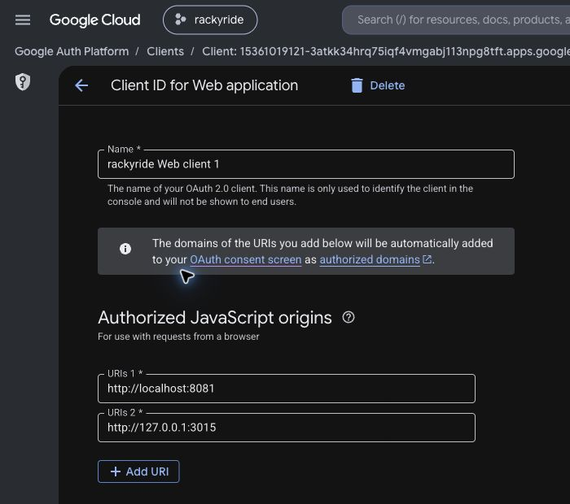

# Google staff sign-in

The login page supports Google alongside the existing phone/OTP flow. It loads the official Google Identity Services script and renders Google's standard button. No new npm dependency or database table is needed. Tokens issued by the shared Express backend remain in HttpOnly browser cookies.

## Configuration

- Backend `.env`: `GOOGLE_CLIENT_ID_WEB` must be the existing OAuth **Web application** client ID.
- Dashboard `.env.local`: `NEXT_PUBLIC_GOOGLE_CLIENT_ID` must match that web ID. This ID is public; it is not a client secret. The current local dashboard was configured from the existing backend web ID without copying other backend secrets.
- Google Cloud Console → Google Auth Platform → Clients → the matching web client → Authorized JavaScript origins: add the exact origin `http://127.0.0.1:3015`. For Google's recommended localhost development setup, add `http://localhost` and `http://localhost:3015`; when running on localhost, also set `DASHBOARD_ORIGIN=http://localhost:3015` and open that hostname consistently.
- Production: authorize the exact HTTPS dashboard origin, set `DASHBOARD_ORIGIN` accordingly and rebuild after changing the public client ID.

On 11 October 2026, the owner approved adding `http://127.0.0.1:3015` to Authorized JavaScript origins on the existing **rackyride Web client 1** in project **rackyride-510222**. Google Cloud confirmed **OAuth client saved**, and reopening the client confirmed the persisted origin. The pre-existing mobile web origin and redirect URI were retained. A fresh dashboard login then opened Google's **Choose an account** screen for Rackyride. The earlier origin-denied blocker is resolved. The button uses popup mode with a JavaScript callback, so no separate application redirect endpoint is required.

Development login now redirects between `localhost` and `127.0.0.1` on the same port to the exact configured `DASHBOARD_ORIGIN`. This fixes the observed `Request origin denied` error when the browser opened `localhost:3015` while session routes accepted only `127.0.0.1:3015`. The redirect does not run in production, does not accept external hosts or mismatched ports, and does not widen the session/mutation Origin allowlist. Only the approved `127.0.0.1:3015` dashboard origin was added to Google Cloud.

The chosen Google identity must belong to an existing active admin/super_admin record. A Google subject already linked to that record is accepted. First-time linking by email is limited to verified Gmail or Google Workspace identities and an unlinked, unambiguous existing active staff record. Other email providers require an existing subject link. Google sign-in does not provision users or staff roles. Initial local staff provisioning remains the separate pending owner decision.

## Request flow

1. The component POSTs `/api/session/google-challenge` on Next. The route checks the exact Origin, creates a random 32-byte nonce, stores it in an HttpOnly/SameSite Strict cookie for ten minutes and returns the nonce for Google's initialization.
2. Google returns a signed ID token containing that nonce after the user chooses an account. The component immediately POSTs `{ idToken }` to `/api/session/google`; it never stores the ID token in browser persistence.
3. Next consumes the nonce cookie and forwards `{ idToken, expectedNonce }` to backend `POST /api/auth/google/staff`. A client-supplied expectedNonce is ignored.
4. The existing `google-auth-library` validates the token for the backend web audience, including signature, issuer and expiry. Staff validation additionally requires a verified email and matching nonce, then locks/checks the existing active staff record.
5. A valid sign-in links an eligible unlinked subject, appends a `staff_google_login` audit entry and issues a staff-scoped access/refresh pair. Next independently checks `/api/auth/me`, writes the existing staff cookies and returns only `{ success: true }` to the browser.

The general mobile `POST /api/auth/google` also accepts the same staff identity, issuing app-only access. Safe first linking follows the same authoritative email rule for provisioned staff; ordinary customer contact email cannot link a Google identity. Admin routes require both staff session scope and a current staff database role. Refresh preserves scope. Phone login in the dashboard verifies through `/api/auth/login/staff/verify`; mobile `/api/auth/login/verify` always issues app-only access. Older unscoped dashboard sessions require a fresh login after backend migration `012_auth_session_scope.sql`.

## Validation

Backend PostgreSQL tests run in disposable schemas; Google verification is mocked at the library boundary. They cover invalid signature/nonce/email, ordinary/inactive accounts, eligible staff linking, wrong linked subject, external-provider email rules, app-only access for staff identities, phone verification, driver approval, refresh scope preservation, legacy sessions and demoted staff. Admin integration checks deny app-scoped staff across the read routes. Production Next session tests cover exact Origin, nonce cookie flags/consumption, ignoring client nonce tampering, nonstaff denial, invalid tokens and token redaction. These tests do not contact a real Google account or alter local users.

Desktop/mobile layout checks use the real Google button. The real Google account chooser was verified after saving the authorized origin. Selecting an existing staff Google identity and completing authentication remain the user's next step; no real-account login is claimed by the verification. The Google staff backend tests, dashboard typecheck/build, seven unit tests and production session checks pass.

References: [Google button setup](https://developers.google.com/identity/gsi/web/guides/get-google-api-clientid), [button rendering](https://developers.google.com/identity/gsi/web/guides/display-button), [nonce API](https://developers.google.com/identity/gsi/web/reference/js-reference#nonce), [server token verification and authoritative email rules](https://developers.google.com/identity/gsi/web/guides/verify-google-id-token).

