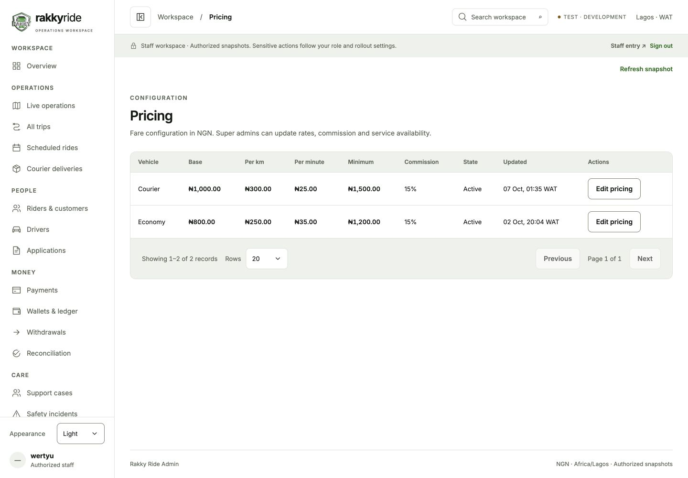
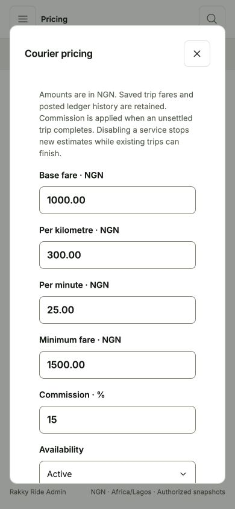

# Table actions and editable settings

Implemented 10 October 2026 in the separate Next.js dashboard and the shared ride-app Express backend.

## Using the controls

Every populated table has a final **Actions** column. On mobile, swipe horizontally inside the table to reach it; tables retain their desktop layout. Actions stay associated with the same row when pagination changes.

- Trips and payments: open the corresponding record and its existing detail workflow.
- Scheduled passenger rides: super admins can **Manage booking** to change pickup time or cancel before dispatch. A booking must still be `scheduled`; pickup must be 30 minutes to 7 days away. Overlapping bookings are rejected. Cancellation follows the trip state machine and releases any wallet hold through the existing append-only payment service.
- Riders/customers and drivers: super admins can **Edit account** to correct the name or activate/deactivate a customer. Accounts with scheduled or active trips cannot be deactivated. Login identifiers, linked Google identities and staff roles cannot be changed by this editor.
- Applications: **Review application** opens the existing document review and approve/reject workflow.
- Support and safety: **Manage case** opens assignment, status and notes controls subject to the existing role restrictions.
- Wallets: **Manage account** opens ledger history and the existing financial controls. Monetary actions retain their separate rollout gate.
- Pricing: super admins can **Edit pricing** to change base fare, per-kilometre rate, per-minute rate, minimum fare, commission percentage and service availability. Disabling a service blocks new estimates; existing trips can settle. Saved quoted fares and existing ledger history remain unchanged. The existing completion flow applies commission configuration at settlement.
- Reports, ratings, health, audit and team rows: **View details** opens a readable record dialog. Aggregates, recorded history, provider observations and staff permissions are not rewritten through generic row editing.

## Payment settings

`/admin/settings/payments` enables every existing persisted configuration field for super admins: minimum/maximum top-up, minimum/daily maximum withdrawal, withdrawal fee, cash debt limit, Paystack balance alert, adjustment threshold, payout-account cooldown, payout name matching and transfer fee tiers. Bounded fee tiers can be added or removed; the final unbounded tier remains required. Upper amounts must increase and minimum limits cannot exceed their maximums.

Amounts are entered in NGN and converted exactly to integer kobo. Commission percentages are converted to integer basis points. **Review changes** displays before/after values and requires a reason before saving. Unchanged or invalid forms cannot be submitted. Backend versions reject stale edits; stable request keys make exact retries safe. Changes are recorded in the protected admin audit log. Refresh after a conflict to load the current version.

The backend enforces super-admin permissions independently of the UI. Browser requests still require HttpOnly staff sessions, the dashboard origin and an explicitly allowed path/method. The obsolete `ENABLE_ADMIN_SETTINGS_ACTIONS` flag no longer blocks owner-approved configuration updates. `ENABLE_ADMIN_MONEY_ACTIONS` continues to govern financial interventions.

## API and source documentation

The shared backend owns the persisted writes:

- `PATCH /api/admin/pricing/:vehicleType`
- `PATCH /api/admin/users/:id`
- `POST /api/admin/trips/:id/schedule`
- Existing `PATCH /api/admin/payments/settings`

The dashboard forwards these through `/api/admin/...`. Detailed bodies, permissions, validation, retry/conflict semantics, effects and source references are in [admin-api-reference.md](/Users/mac/Desktop/ride_app/backend/docs/admin-api-reference.md). The generated [admin-api-implementation.md](/Users/mac/Desktop/ride_app/backend/docs/admin-api-implementation.md) includes the implementation source and checksums.

## Verification

All 21 main pages were checked with actual local database responses at 390px and 320px. Every populated table included the Actions column and scrolled inside its own region; no document overflow was found. Empty local queues were left empty. See [row-actions-review.json](./row-actions-review.json).

Pricing, account and settings confirmation dialogs were checked on mobile without saving live database changes. API mutation tests use disposable PostgreSQL schemas and cover permissions, malformed inputs, stale versions, concurrent writes, exact retries, name/status persistence, schedule overlap and cancellation, and immutable financial history. Dashboard session tests verify authenticated forwarding, origin protection and method restrictions for the new routes.

